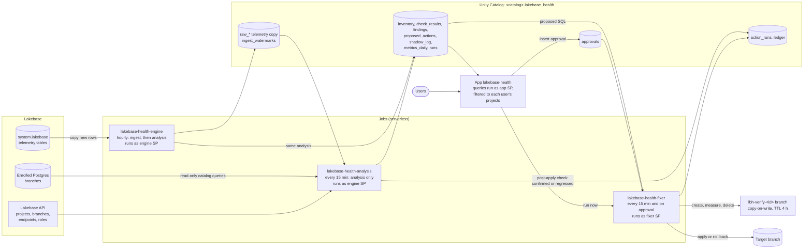

# Lakebase Health

Lakebase Health checks every Lakebase (autoscaling Postgres) project in your Databricks account and tells you
what is wrong, how bad it is and what to do about it. It copies the `system.lakebase` telemetry into Delta,
runs deterministic, thresholded checks over that copy, the Lakebase API and (for projects you enrol) the Postgres
catalog, and shows the findings in a Databricks App. For a small set of fixes (index create and drop, `ANALYZE`,
per-table autovacuum settings) a project manager can approve the fix in the app; a separate fixer job then tests it
on a copy-on-write branch, applies it after a second approval, and the engine confirms the result or flags a
regression.

Everything is one Databricks Asset Bundle: three jobs and one app.

| Part | What it is |
|---|---|
| Engine job `lakebase-health-engine` | Hourly. Copies new `system.lakebase` rows into `raw_*` Delta tables, then runs the analysis. Read-only. |
| Analysis job `lakebase-health-analysis` | Every 15 minutes. Analysis only (inventory, checks, record, post-apply check) over the telemetry already copied. Read-only. |
| Fixer job `lakebase-health-fixer` | Every 15 minutes, and started by the app on each approval. Verifies, applies and rolls back approved fixes. |
| App `lakebase-health` | AppKit (TypeScript and React). Fleet, project, finding and timeline views, plus fix and approval cards. |

A health report page with a score and an HTML export is designed but **planned, not built**
(`docs/superpowers/specs/2026-10-28-lakebase-health-report-design.md`, on the `feature/engine` branch).

## Architecture



How the data flows:

1. **Ingest (hourly, engine SP).** For each of the 10 `system.lakebase` tables in turn, the engine inserts the rows
   newer than its watermark into `raw_<table>`. The first run backfills 7 days. It runs one statement per table and
   never in parallel, because `system.lakebase` statements spend minutes compiling (see [DESIGN.md](DESIGN.md) §2a).
2. **Inventory.** The engine lists projects, branches, endpoints and roles through the Lakebase API: compute state,
   CU range, suspend timeout, HA, restore window, branch protection, password roles, and whether the engine has a
   Postgres role on the branch (enrolled).
3. **Checks.** Telemetry checks run as SQL over `raw_*` for every project. API checks run over the inventory.
   Postgres checks run only on enrolled branches whose read-write compute is already running; the engine never
   wakes a suspended compute.
4. **Record.** Results go to `check_results`; `findings` holds the current state of each problem. Fixes with SQL
   become rows in `proposed_actions`, with a shadow-mode verdict in `shadow_log` and an event in the hash-chained
   `ledger`.
5. **App.** The app reads these tables through a SQL warehouse as its own service principal and filters every
   query to the projects the signed-in user may see.
6. **Fix.** An approver clicks a button on a fix card. The app inserts a row into `approvals` and starts the fixer
   job. The fixer checks that the approved SQL hash still matches, creates `lbh-verify-<id>` from the target branch,
   measures the affected queries before and after the change, deletes the branch and records a report. After a
   second approval it applies the same SQL to the target branch.
7. **Post-apply check.** After two successful engine or analysis runs, the engine marks the fix `confirmed` or
   `regressed`. A regression raises a critical `fix_regressed` finding and a rollback card.

## Identities and privileges

There are three service principals (SPs). The engine is read-only: it never changes a customer database, never
creates branches and never wakes a compute. Only the fixer can write to Postgres, and only SQL that a person
approved.

| Identity | Runs | Can | Cannot |
|---|---|---|---|
| Engine SP (`engine_sp`) | Engine and analysis jobs | Read `system.lakebase`. Create and own `<catalog>.lakebase_health` (tables, the `mask_text` function, column masks). List the Lakebase projects it has `CAN_USE` on. Connect to enrolled branches as a role with only `pg_monitor`, in sessions with `default_transaction_read_only`, `statement_timeout = 30s` and `lock_timeout = 1s`. | Write to any Postgres database (it has no table, schema or database privileges). Wake a suspended compute. Create branches. Approve or apply fixes. |
| Fixer SP (`fixer_sp`) | Fixer job | `SELECT` on `<catalog>.lakebase_health`; `MODIFY` on `proposed_actions`, `action_runs`, `ledger` and `shadow_log` only. Create and delete `lbh-verify-*` branches on projects where it has `CAN_MANAGE`. Run approved statements as a member of the role that owns the target tables. | Run anything outside its allowlist: `CREATE INDEX CONCURRENTLY` (non-unique), `DROP INDEX CONCURRENTLY`, `ANALYZE <table>`, `ALTER TABLE <table> SET\|RESET (autovacuum_*)`, one statement on one object, no comments or literals. Act without an approval row whose SQL hash matches. Write `findings` or `approvals`. Touch a project where it has no Postgres role. |
| App SP (created by Databricks Apps) | The app | `SELECT` on `<catalog>.lakebase_health`. `MODIFY` on `approvals` (Unity Catalog has no insert-only privilege; every consumed approval is recorded in the hash-chained ledger). `CAN_MANAGE_RUN` on the fixer job. `CAN_USE` on the SQL warehouse. | Connect to Postgres, hold Lakebase project permissions, or write any other table. Per-user checks (project visibility, approver rights, group membership) use the signed-in user's token and GET calls only. |

`CAN_MANAGE` on a project is broader than what the fixer uses (the code only creates and deletes `lbh-verify-*`
branches), but creating a branch requires it; `CAN_USE` is rejected.

Least-privilege grants, all applied in [Setup](#setup):

| To | Grant | Who runs it |
|---|---|---|
| Engine SP | `USE SCHEMA` and `SELECT` on schema `system.lakebase` | Account admin who is also metastore admin |
| Engine SP | `USE CATALOG`, `CREATE SCHEMA` on `<catalog>` | Catalog owner |
| Engine SP | `CAN_USE` on each Lakebase project to inventory | Project owner |
| Engine SP | Postgres role with `pg_monitor`, per branch (optional) | Project owner |
| Engine and fixer SPs | `CAN_READ` on the bundle's workspace folder (to install the wheel) | Deployer (`scripts/fixer_grants.sh`) |
| Fixer SP | `USE CATALOG`; `USE SCHEMA` and `SELECT` on the schema; `MODIFY` on 4 tables | Catalog owner (`scripts/fixer_grants.sh`) |
| Fixer SP | `CAN_MANAGE` on the project, and a Postgres role that is a member of the table-owner role, per project (optional) | Project owner |
| App SP | `USE CATALOG`; `USE SCHEMA` and `SELECT` on the schema | Catalog owner |
| App SP | `MODIFY` on `approvals`; `CAN_MANAGE_RUN` on the fixer job | Catalog owner (`scripts/fixer_grants.sh`) |
| Engine, fixer and app SPs | Member of the account group `databricks_pii_access` (only when PII masking is on) | Account admin |

## Prerequisites

- A Databricks workspace with Lakebase autoscaling projects, Unity Catalog, serverless jobs compute and Databricks
  Apps. Lakebase observability in system tables must be enabled (a workspace admin setting), so that
  `system.lakebase` has data.
- An account admin who is also a metastore admin, to grant read on `system.lakebase` and to manage the
  `databricks_pii_access` group.
- A Unity Catalog catalog you own (or whose owner can run grants) to hold the `lakebase_health` schema.
- A SQL warehouse for the app (serverless starts fastest). Find its ID with `databricks warehouses list`.
- On the machine you deploy from: Databricks CLI v1.17.0 (the version these instructions were checked with), `python3` with
  `pip` (the bundle builds the engine wheel with `python3 -m pip wheel`), and `psql` for the optional Postgres
  enrolment. Node.js is not needed locally; Databricks Apps installs and builds the app.
- A CLI profile for the workspace (`databricks auth login --host <workspace-url>`). The scripts take it as
  `PROFILE=<profile>`; add `-p <profile>` to the other commands if it is not your default profile.

## Setup

### 1. Create the service principals

```bash
databricks service-principals create --display-name lakebase-health-engine -o json
databricks service-principals create --display-name lakebase-health-fixer -o json
```

Note each `applicationId`; the rest of this guide calls them `<engine-sp-application-id>` and
`<fixer-sp-application-id>`. The app's service principal is created when the app is deployed (step 3).

Give yourself (the deployer) the **Service principal: User** role (`servicePrincipal.user`) on both SPs, on each
SP's Permissions tab in the workspace settings. A bundle cannot deploy a job that runs as an SP without it.

Grant the engine read on the telemetry, as an account admin who is also metastore admin. If `account users`
already has `SELECT` on the `system` catalog, this is inherited.

```sql
GRANT USE SCHEMA ON SCHEMA system.lakebase TO `<engine-sp-application-id>`;
GRANT SELECT ON SCHEMA system.lakebase TO `<engine-sp-application-id>`;
```

Grant the engine its catalog, as the catalog owner. If a `lakebase_health` schema already exists (for example from
an earlier install under another identity), also grant `USE SCHEMA, CREATE TABLE, CREATE FUNCTION, SELECT, MODIFY,
EXECUTE` on it, and see step 5.

```sql
GRANT USE CATALOG, CREATE SCHEMA ON CATALOG <catalog> TO `<engine-sp-application-id>`;
```

Give the engine `CAN_USE` on each Lakebase project it should inventory. `<project-id>` is the ID in
`projects/<project-id>`, not the project's UID. Projects it cannot see still get telemetry checks, but no
inventory, API checks or Postgres checks.

```bash
databricks permissions update database-projects <project-id> \
  --json '{"access_control_list":[{"service_principal_name":"<engine-sp-application-id>","permission_level":"CAN_USE"}]}'
```

If you keep PII masking on (the default on the `prod` target), do step 8 now, before the first engine run. Rows
the engine copies while it is outside `databricks_pii_access` keep `<REDACTED>` text for good.

### 2. Choose bundle variables and a target

Variables (from `databricks.yml`):

| Variable | Default | Meaning |
|---|---|---|
| `catalog` | required | Catalog that holds the `lakebase_health` schema |
| `schema` | `lakebase_health` | Schema for the tables. Keep the default: `scripts/fixer_grants.sh` assumes it. |
| `engine_sp` | required | Application ID of the engine SP |
| `fixer_sp` | required | Application ID of the fixer SP. The fixer job is always deployed; it does nothing on projects you do not enrol for fixes. |
| `warehouse_id` | required for the app | SQL warehouse the app queries; the app SP gets `CAN_USE` on it |
| `schedule` | `0 0 * * * ?` (hourly) | Quartz cron for the engine (ingest and analysis). Ingest takes about 20 minutes, so keep it at 30 minutes or more. |
| `ingest_interval_minutes` | `60` | Minutes between engine runs; keep it in step with `schedule`. Sources go stale after twice this, and the app's stale banner uses it too. |
| `analysis_schedule` | `0 0/15 * * * ?` | Quartz cron for the analysis-only job |
| `pii_masking` | `"true"` | `"true"` masks query text, plans and parameters for anyone outside `databricks_pii_access`. Only the exact string `"false"` turns masking off. See [PII masking](#pii-masking). |
| `engine_enabled` | `"true"` | `"false"` makes every engine and analysis run stop at once with status `disabled` |

Targets:

| Target | Mode | Use |
|---|---|---|
| `prod` | production | **Use this one.** Schedules are active and `pii_masking` keeps its default `"true"`. |
| `dev` (default) | development | The maintainers' test workspace. Job names get a `[dev <user>]` prefix, schedules are deployed paused, and `pii_masking` is set to `"false"`. |

The fixer job's schedule (every 15 minutes) is set in `resources/fixer_job.yml`, not by a variable.

### 3. Deploy

```bash
VARS=(--var catalog=<catalog> --var engine_sp=<engine-sp-application-id>
      --var fixer_sp=<fixer-sp-application-id> --var warehouse_id=<warehouse-id>)
databricks bundle deploy -t prod "${VARS[@]}"
databricks bundle summary -t prod "${VARS[@]}"
```

Then find the app's service principal (`<app-sp-application-id>` below):

```bash
databricks apps get lakebase-health -o json   # field service_principal_client_id
```

### 4. Run the engine once, then the grants script

On a fresh install the grants script needs tables that only the engine creates, and the engine needs read access
to the deployed wheel, which the grants script gives. So grant the folder read first, run the engine once, then
run the script.

Grant both SPs `CAN_READ` on the bundle's workspace folder (the same commands the script runs):

```bash
databricks bundle validate -t prod "${VARS[@]}"             # prints Path: <bundle-root-path>
databricks workspace get-status <bundle-root-path> -o json  # field object_id
databricks permissions update directories <object-id> --json '{"access_control_list":[
  {"service_principal_name":"<engine-sp-application-id>","permission_level":"CAN_READ"},
  {"service_principal_name":"<fixer-sp-application-id>","permission_level":"CAN_READ"}]}'
```

Run the engine job once. It creates the schema and tables and backfills 7 days of telemetry, so it takes longer
than later runs.

```bash
databricks bundle run lakebase_health_engine -t prod "${VARS[@]}"
```

Then, from the repo root, as the catalog owner:

```bash
DATABRICKS_BUNDLE_TARGET=prod PROFILE=<profile> CATALOG=<catalog> WAREHOUSE=<warehouse-id> \
  ENGINE_SP=<engine-sp-application-id> FIXER_SP=<fixer-sp-application-id> APP_SP=<app-sp-application-id> \
  scripts/fixer_grants.sh
```

The script grants the fixer `USE CATALOG`, `USE SCHEMA` and `SELECT`, plus `MODIFY` on `proposed_actions`,
`action_runs`, `ledger` and `shadow_log`; the app SP `MODIFY` on `approvals` and `CAN_MANAGE_RUN` on the fixer
job; and both job SPs `CAN_READ` on the bundle folder. It works on the target in `DATABRICKS_BUNDLE_TARGET`
(default `dev`): the fixer job is the ID `databricks bundle summary` reports for that target, and the folder is the
target's root path from `databricks bundle validate`. Re-run it if the bundle root path changes.

Grant the app read access, as the catalog owner (the script does not do this):

```sql
GRANT USE CATALOG ON CATALOG <catalog> TO `<app-sp-application-id>`;
GRANT USE SCHEMA, SELECT ON SCHEMA <catalog>.lakebase_health TO `<app-sp-application-id>`;
```

### 5. One-time grants for tables a person created

The engine sets or drops column masks on its tables, which needs `MANAGE` on the table (or owning it). Tables the
engine SP created are its own. If a table was first created by a person (for example by an earlier run as that
person), grant the engine `MANAGE` on each masked table. Otherwise the `pii_masking` switch fails with
`PERMISSION_DENIED` in the run's errors and the masks stay as they were.

```sql
GRANT MANAGE ON TABLE <catalog>.lakebase_health.raw_plan_history TO `<engine-sp-application-id>`;
GRANT MANAGE ON TABLE <catalog>.lakebase_health.raw_pg_stat_statements_counters TO `<engine-sp-application-id>`;
GRANT MANAGE ON TABLE <catalog>.lakebase_health.raw_ddl_history TO `<engine-sp-application-id>`;
GRANT MANAGE ON TABLE <catalog>.lakebase_health.raw_postgres_logs TO `<engine-sp-application-id>`;
GRANT MANAGE ON TABLE <catalog>.lakebase_health.check_results TO `<engine-sp-application-id>`;
GRANT MANAGE ON TABLE <catalog>.lakebase_health.findings TO `<engine-sp-application-id>`;
```

### 6. Enroll a project for Postgres checks

Optional, per branch. Telemetry and API checks cover every project automatically. The Postgres checks (indexes,
vacuum, sequences, sessions, locks, settings) need a Postgres role for the engine SP on the branch with
`pg_monitor`, which includes `pg_read_all_stats` and `pg_read_all_settings`. Project owners can grant `pg_monitor`
but not `pg_read_all_stats` directly. Grant nothing else: the role needs no table, schema or database privileges.

```bash
databricks postgres list-branches projects/<project-id>
databricks postgres create-role projects/<project-id>/branches/<branch-id> --role-id lakebase-health-engine \
  --json '{"spec": {"identity_type": "SERVICE_PRINCIPAL", "postgres_role": "<engine-sp-application-id>", "auth_method": "LAKEBASE_OAUTH_V1"}}'
```

Then, connected to the branch as its owner:

```sql
GRANT pg_monitor TO "<engine-sp-application-id>";
```

`scripts/pg.sh` opens `psql` on an endpoint with a fresh OAuth token, as your CLI user. Find the endpoint with
`databricks postgres list-endpoints projects/<project-id>/branches/<branch-id>`.

```bash
PROFILE=<profile> EP=projects/<project-id>/branches/<branch-id>/endpoints/<endpoint-id> \
  scripts/pg.sh -c 'GRANT pg_monitor TO "<engine-sp-application-id>";'
```

The app's **Postgres checks** column turns **on** once the role exists, at the next analysis run. The engine only
connects to computes that are already running.

### 7. Enroll a project for fixes

Optional, per project. The fixer needs three things on the project.

1. `CAN_MANAGE` on the project (creating the verification branch requires it; `CAN_USE` is not enough):
   ```bash
   databricks permissions update database-projects <project-id> \
     --json '{"access_control_list":[{"service_principal_name":"<fixer-sp-application-id>","permission_level":"CAN_MANAGE"}]}'
   ```
2. A Postgres role on the target branch:
   ```bash
   databricks postgres create-role projects/<project-id>/branches/<branch-id> --role-id lakebase-health-fixer \
     --json '{"spec": {"identity_type": "SERVICE_PRINCIPAL", "postgres_role": "<fixer-sp-application-id>", "auth_method": "LAKEBASE_OAUTH_V1"}}'
   ```
3. Membership in the role that owns the target tables, and `USAGE` on their schema for that owner role. On the
   branch, as an admin of the owner role:
   ```sql
   GRANT <owner_role> TO "<fixer-sp-application-id>";
   GRANT USAGE ON SCHEMA <schema> TO <owner_role>;   -- the owner role must reach its tables
   ```

If the tables are owned by a person's login role (for example `"alice@example.com"`), the `GRANT` fails on
Postgres 16 and later ("Only roles with the ADMIN option on role ... may grant this role"): the person has no
ADMIN option on their own role. Move ownership to a `NOLOGIN` group role instead, as the current owner (who needs
`CREATEROLE`; the creator gets ADMIN on the new role):

```sql
CREATE ROLE app_owner NOLOGIN;
GRANT app_owner TO "alice@example.com" WITH INHERIT TRUE, SET TRUE;  -- the person keeps owner rights
GRANT USAGE ON SCHEMA <schema> TO app_owner;                          -- the owner role must reach its tables
ALTER TABLE <schema>.<table> OWNER TO app_owner;                      -- once per target table
GRANT app_owner TO "<fixer-sp-application-id>";
```

Without these, a verify or apply request ends `blocked` with the missing privilege, and the card offers
**Retry after enrolment**.

### 8. The `databricks_pii_access` group

Skip this step if you deploy with `pii_masking` set to `"false"`.

With masking on, Databricks masks query text, plans and bind parameters in `system.lakebase` for anyone outside the
account group `databricks_pii_access`, and the engine applies the same rule to its own copies through the
`mask_text` column masks. In the account console, create the group if it does not exist and add:

| Member | Why |
|---|---|
| Engine SP | To copy real query text from `system.lakebase`; otherwise the copies hold `<REDACTED>` |
| Fixer SP | Branch verification finds the affected queries by their text; otherwise verification fails with "no sampled queries on this table could be measured" |
| App SP | The app reads the tables as its SP; otherwise it gets `<REDACTED>` and no user sees query text in the app |
| People who query the tables directly | To see text in SQL |

In the app, with masking on, full query text goes to members of `databricks_pii_access`, the project owner and
workspace admins. Everyone else sees a normalized skeleton (literals and bind values replaced) or the query ID.

### 9. App access

Give people `CAN_USE` on the app:

```bash
databricks apps update-permissions lakebase-health \
  --json '{"access_control_list":[{"group_name":"<group>","permission_level":"CAN_USE"}]}'
```

The app runs with user authorization (scopes `sql` and `postgres`); users consent on first open. It decides what
each user sees with their own token:

- Workspace admins (the `admins` group) see every project.
- Everyone else sees the projects they own, or where they hold a Lakebase Postgres role on any branch, directly or
  through a group. The Lakebase API lists every project to every workspace user, so the app does not treat that
  list as a permission.
- Access is cached for 5 minutes per user; **Refresh access** on the empty fleet page clears it. A request for a
  project the user cannot see returns 404.
- Only the project owner or users with `CAN_MANAGE` on the project can approve fixes. Others who can see the
  project see the cards, and the server refuses their clicks (403).

### 10. Verify the install

1. `databricks bundle summary -t prod "${VARS[@]}"` lists the three jobs and the app.
2. The latest run succeeded. In a SQL editor:
   ```sql
   SELECT started_at, status, step_seconds, errors
   FROM <catalog>.lakebase_health.runs ORDER BY started_at DESC LIMIT 5;
   ```
   `status` is `ok`, or `ok_with_errors` with the failures listed in `errors` (one per source table, project or
   check; the rest of the run still completes).
3. The inventory sees your projects and their enrolment:
   ```sql
   SELECT project_name, branch_name, endpoint_name, current_state, enrolled
   FROM <catalog>.lakebase_health.inventory
   WHERE run_id = (SELECT run_id FROM <catalog>.lakebase_health.runs ORDER BY started_at DESC LIMIT 1);
   ```
4. Open the app (`databricks apps get lakebase-health -o json`, field `url`) as a workspace admin. The fleet lists
   your projects with finding counts and the time of the last run.
5. If you enrolled a project for fixes, the fixer job's runs succeed (`databricks bundle summary` links to it).

## Using the app

| View | Path | What it shows |
|---|---|---|
| Fleet | `/` | Every project you can see: open critical, warning and info counts, newest finding, active computes, and whether Postgres checks are on. Fleet totals and the last engine run. |
| Project | `/projects/<id>` | Open findings grouped by category, with severity, object, first and last seen, occurrences and confidence. Query findings show one row per query, with a badge per issue. Findings resolved in the last 7 days, collapsed. A computes panel: state, CU range, suspend timeout, HA, restore window, branch protection and **Postgres checks on/off**, with the grant to run when off. |
| Finding | `/findings/<fingerprint>` | What it means, the measure over time, the evidence, the candidate fix and rollback, the shadow-mode verdict (what an unattended policy would have done) and related findings on the same endpoint. Incident findings link to the timeline. |
| Timeline | `/endpoints/<id>/timeline` | One endpoint, up to 7 days on one time axis: active sessions by wait class, lock waits by blocker (commit wait, idle in transaction, active, not sampled), `SyncRep` commit waits, CPU and connections, and statement timeouts, connection drops and restarts as events. Click a moment to list the sampled sessions. |
| Fixes and approvals | `/projects/<id>/actions` | Every proposed fix for the project, grouped by state, each with its card. |

Data is as of the last engine or analysis run. When the last successful run is too old, every page shows a banner.

### Fix workflow

Only fixes that the fixer's allowlist accepts can be run from the app: missing foreign-key indexes; duplicate,
redundant and unused indexes; `ANALYZE` for stale statistics; and per-table autovacuum settings. The checks
summary below marks each one.

1. **Verify on a branch.** The fixer creates `lbh-verify-<id>` from the target branch (TTL 4 hours, 1 to 2 CU,
   scale to zero after 5 minutes). It takes up to 10 queries that touched the table in the last 24 hours (by total
   time, with up to 3 sampled parameter sets each), runs each 3 times before and after the change with
   `EXPLAIN (ANALYZE, BUFFERS)` inside a transaction that is rolled back, then deletes the branch. The card shows
   the report (query IDs and timings, never query text). A new index passes when at least one read query uses it
   with a speed-up of 1.2x or more, no read query is more than 10% slower and no sampled write is more than 25%
   slower. A dropped index passes when no measured plan used it and no measured query is more than 10% slower.
   `ANALYZE` and autovacuum settings have no branch pass rule and can go straight to apply.
2. **Apply.** After verification passes, a second approval applies the same SQL to the target branch with
   `lock_timeout = 5s` and a 2-hour statement timeout for index builds. Apply may wake a suspended compute,
   because a person approved it. A failed `CREATE INDEX CONCURRENTLY` leaves an invalid index; the fixer drops it.
3. **Confirmed or regressed.** After two successful engine or analysis runs, the post-apply check marks the fix
   `confirmed` when the finding has resolved (or its measure dropped by a quarter), the mean time of the
   endpoint's sampled queries is at most 10% worse than in the 24 hours before, and the lock wait share has not
   risen by more than 5 points. Otherwise it marks it `regressed` and raises a critical `fix_regressed` finding.
   With fewer than 50 calls since the apply, a resolved finding is enough: `confirmed` with low confidence.
4. **Roll back.** A regressed (or applied) fix shows a rollback card; rolling back needs another approval.

Each request is checked against the SQL hash the approver saw. If the proposed SQL has changed, the approval is
ignored (`stale_approval`) and the card asks for a new review. Every state change is a ledger event. Unapproved
actions expire after 7 days, or when their finding resolves.

Known limit: the stored rollback for a dropped index is the original `CREATE INDEX` statement without
`CONCURRENTLY`, which the allowlist refuses, so that rollback ends `blocked`. Recreate the index yourself from the
rollback SQL on the card, adding `CONCURRENTLY`.

Who can approve: the project owner, or a user with `CAN_MANAGE` on the Lakebase project. The app checks this with
the user's own token on every click and records the approver's user name.

## Operations

### Schedules

| Job | Default | Runtime | Notes |
|---|---|---|---|
| `lakebase-health-engine` | hourly (`schedule`) | about 20 minutes, mostly ingest | Keep at 30 minutes or more. Also sets or drops the column masks. |
| `lakebase-health-analysis` | every 15 minutes (`analysis_schedule`) | a few minutes | Never reads `system.lakebase`; safe to run on demand, for example right after applying a fix. |
| `lakebase-health-fixer` | every 15 minutes, plus a run per approval | short when nothing is queued | Handles one action per project at a time. |

Each job runs one instance at a time (`max_concurrent_runs: 1`). A telemetry source whose newest copied row is
older than twice `ingest_interval_minutes` (2 hours by default) counts as stale, and checks that read it report
`ok_stale_source`. The app's staleness banner uses the same variable. If you change `schedule`, set
`ingest_interval_minutes` to match.

To stop all engine work, deploy with `--var engine_enabled=false`.

### Cost

- The engine and analysis jobs run on serverless jobs compute. Ingest is the main cost: about 20 minutes per hour.
  The analysis job takes a few minutes every 15 minutes; lengthen `analysis_schedule` if you do not need findings
  that fresh.
- The app's queries run on your SQL warehouse; use auto-stop.
- Postgres checks run short catalog queries, only on computes that are already running, so they never keep a
  compute awake on their own. The bloat checks (`pgstattuple`) run once a day.
- Each verification creates a branch with a 1 to 2 CU compute that is deleted when the verification ends (TTL 4
  hours as a backstop). A project allows 10 unarchived branches.
- Retention: `raw_*` and `check_results` keep 90 days; `findings`, `ledger`, `shadow_log` and `metrics_daily` are
  kept indefinitely.

### What is excluded

Lakebase platform objects never produce findings (`engine/src/lakebase_health/checks/exclusions.yaml`):

- Replication slots `wal_retention_slot` and `wal_proposer_slot`.
- Platform roles and users: `cloud_admin`, `databricks_control_plane`, `databricks_superuser`, `databricks_monitor`,
  `authenticator` (the Data API role), and roles matching `^(pg_|databricks_)`.
- Schemas `pg_catalog`, `information_schema`, `pg_toast`, `hint_plan` and `sage`.
- Platform settings (`databricks.*`, `neon.*`, `neon_*`, `neon_monitor.*`, `compute_ctl.*`, `lakebase.*`).
- Query checks also drop the telemetry of synced-table writers (`databricks_writer_<n>`), platform agents, and the
  engine and fixer SPs and their application names (`lakebase-health`, `lakebase-health-fixer`).

To opt a project out, add the custom tag `lakebase_health = off` to it. API and Postgres checks then skip it
(`skipped:opted_out`). Telemetry checks still cover it, because they run over the account-wide copy.

### Finding lifecycle

| Status | Meaning |
|---|---|
| `new` | Reported for the first time |
| `open` | Reported again |
| `suppressed` | Still reported, but `suppressed_until` is in the future. The app has no suppress control yet; set the column in `findings` with SQL. |
| `superseded` | A more specific finding for the same object, database or endpoint is open and at least as severe. Kept with its history; returns to `open` when the other one clears. Not counted and not acted on. |
| `resolved` | Its check ran successfully twice in a row for that scope without reporting it |

A skipped, failed or timed-out check never resolves or changes a finding.

### PII masking

Query text, plans and bind parameters in the `raw_*` tables, `findings` and `check_results` are masked
(`<REDACTED>`) for anyone outside `databricks_pii_access`, and the app shows text as described in step 8.
`--var pii_masking=false` turns this off: the engine drops the column masks on its next run (engine or analysis
job; both apply the setting), and every app user sees query text. Rows copied while masking was on keep the
literal `<REDACTED>`; the fixer cannot sample them, and its verification report says so.

The `dev` target sets `pii_masking` to `"false"`: the maintainers chose to show query text to everyone on their
test workspace for now. To turn masking back on:

1. Add the engine SP, the fixer SP, the app SP and every user who should see text to `databricks_pii_access`.
2. Remove `pii_masking: "false"` from the target in `databricks.yml` (or deploy with `--var pii_masking=true`),
   redeploy, and run the engine job once to restore the masks.

### Troubleshooting

| Symptom | Cause and fix |
|---|---|
| `bundle deploy` fails creating a job that runs as an SP | The deployer needs the **Service principal: User** role (`servicePrincipal.user`) on the engine and fixer SPs. |
| A job fails before the engine starts, unable to install the wheel | The job SP cannot read the bundle folder. Run the folder grant in step 4 (or `scripts/fixer_grants.sh`). Re-run it if the bundle root path changes. |
| `fixer_grants.sh` stops with `FAILED: GRANT ... lakebase_health ...` | The engine has not created the schema and tables yet. Run the engine job once (step 4). |
| The app build fails during `npm install` with a 404 | The Databricks Apps npm proxy does not serve every package version. It returned 404 for every version of `@fontsource/dm-sans` and `@fontsource/dm-mono` tried, so those fonts are vendored in `app/client/src/fonts`. Do not add them back as npm dependencies; pin or vendor any other package that 404s. |
| "Request recorded. The fixer could not be started now" | The app SP lacks `CAN_MANAGE_RUN` on the fixer job (run the grants script). The fixer's 15-minute schedule picks up the request anyway. |
| Verification fails with `branch_unavailable` and PermissionDenied | The fixer SP has `CAN_USE` instead of `CAN_MANAGE` on the project (step 7), or the project is at its branch limit. |
| A fix is `blocked` with `42501` (permission denied for schema or table) | The owner role lacks `USAGE` on the schema, or the fixer is not a member of the owner role (step 7). Fix the grant, then use **Retry after enrolment**. |
| `GRANT <owner_role>` fails: "Only roles with the ADMIN option ..." | The tables belong to a person's login role. Move ownership to a `NOLOGIN` role (step 7). |
| Verification fails: "no sampled queries on this table could be measured" | With masking on, the fixer SP is not in `databricks_pii_access`, so it sees `<REDACTED>` text. Or the table had no sampled queries in the last 24 hours. |
| `pii_masking=false` is deployed, but text is still `<REDACTED>` and `runs.errors` shows `PERMISSION_DENIED ... MANAGE` | The tables were created by a person. Grant `MANAGE` (step 5) and run the engine or analysis job. |
| Query text is `<REDACTED>` for everyone, with masking on | The engine SP was outside `databricks_pii_access` when the rows were copied (they stay redacted), or the app SP is not a member. |
| Postgres checks show **off** | No Postgres role for the engine SP on that branch (step 6). |
| Postgres checks are on, but results are `skipped:compute_inactive` | The compute was suspended at run time. The engine never wakes it; results appear on a run while it is active. |
| Checks report `ok_stale_source` | Ingest for that source failed or is behind. Look at `runs.errors` and `ingest_watermarks`; the next engine run retries from the watermark. |
| No telemetry for a project | Lakebase observability in system tables is off for the workspace, or the endpoint is not exporting. On the endpoint, `SHOW neon_monitor.log_capture_enabled;` and `SHOW databricks.o11y_exporter_enabled;` must both be `on`; if not, restart the endpoint. |
| A user sees no projects | They do not own a project or hold a Postgres role on one. Grant a role, then use **Refresh access**. |
| An approve button returns 403 | Only the project owner or `CAN_MANAGE` holders can approve. |

### Uninstall

1. Remove the jobs, the app and the deployed files: `databricks bundle destroy -t prod "${VARS[@]}"`.
2. Drop the data. The engine created it, so `bundle destroy` leaves it:
   `DROP SCHEMA <catalog>.lakebase_health CASCADE;`
3. On each enrolled branch, remove the Postgres roles:
   ```bash
   databricks postgres delete-role projects/<project-id>/branches/<branch-id>/roles/lakebase-health-engine
   databricks postgres delete-role projects/<project-id>/branches/<branch-id>/roles/lakebase-health-fixer
   ```
   A `NOLOGIN` owner role you created in step 7 stays; it is your role now.
4. Remove the SPs' project permissions and `databricks_pii_access` membership, then delete the SPs.

Verification branches (`lbh-verify-*`) are deleted after each verification and expire after 4 hours at most.

## Checks

Checks are data: one YAML file each under `engine/src/lakebase_health/checks/{telemetry,postgres,api}`, holding
the SQL, thresholds, explanation and candidate fix. To change a threshold, edit the file and redeploy. After any
change, regenerate this table and [docs/CHECKS.md](docs/CHECKS.md):

```bash
python3 scripts/gen_checks_doc.py           # needs PyYAML
python3 scripts/gen_checks_doc.py --check   # exits 1 if the docs are out of date
```

<!-- CHECKS_START: generated by scripts/gen_checks_doc.py; do not edit by hand -->

64 checks. Full explanations, thresholds and fixes: [docs/CHECKS.md](docs/CHECKS.md).

| Area | Check | What it finds | Source | Severities | Fixer |
|---|---|---|---|---|---|
| incidents | [`commit_quorum_wait`](docs/CHECKS.md#commit_quorum_wait) | Commits wait for the WAL storage quorum | telemetry | warning / critical | - |
|  | [`deadlocks`](docs/CHECKS.md#deadlocks) | Deadlocks detected | telemetry | warning / critical | - |
|  | [`gin_cleanup_lock_wait`](docs/CHECKS.md#gin_cleanup_lock_wait) | Writes wait for a GIN pending-list cleanup | telemetry | warning / critical | - |
|  | [`hot_row_lock`](docs/CHECKS.md#hot_row_lock) | Writes wait on a row lock | telemetry | warning / critical | - |
|  | [`idle_in_tx_time`](docs/CHECKS.md#idle_in_tx_time) | Sessions spend a lot of time idle in transaction | telemetry | warning / critical | - |
|  | [`lock_blocking_history`](docs/CHECKS.md#lock_blocking_history) | Sessions were blocked by other sessions | telemetry | warning / critical | - |
|  | [`lock_wait_share`](docs/CHECKS.md#lock_wait_share) | Lock waits are a large share of wait time | telemetry | warning / critical | - |
|  | [`postgres_errors`](docs/CHECKS.md#postgres_errors) | Infrastructure-level Postgres errors | telemetry | warning / critical | - |
|  | [`statement_timeouts`](docs/CHECKS.md#statement_timeouts) | Statements cancelled by statement_timeout | telemetry | info / warning / critical | - |
|  | [`blocked_session`](docs/CHECKS.md#blocked_session) | Session blocked by another session | postgres | warning / critical | - |
|  | [`idle_in_transaction`](docs/CHECKS.md#idle_in_transaction) | Session idle inside an open transaction | postgres | warning / critical | - |
|  | [`long_transaction`](docs/CHECKS.md#long_transaction) | Long-running transaction | postgres | warning / critical | - |
| performance | [`disk_spill`](docs/CHECKS.md#disk_spill) | Query spills sorts or hashes to disk | telemetry | warning / critical | by hand |
|  | [`plan_flip`](docs/CHECKS.md#plan_flip) | Query switches between fast and slow plans | telemetry | warning / critical | - |
|  | [`query_regression`](docs/CHECKS.md#query_regression) | Query got slower than its baseline | telemetry | warning / critical | - |
|  | [`row_misestimate`](docs/CHECKS.md#row_misestimate) | Planner row estimates are far off | telemetry | info / warning / critical | - |
|  | [`sort_limit_waste`](docs/CHECKS.md#sort_limit_waste) | Sort reads far more rows than the LIMIT returns | telemetry | warning / critical | - |
|  | [`storage_wait`](docs/CHECKS.md#storage_wait) | Query waits on remote storage | telemetry | warning / critical | - |
|  | [`top_db_time_query`](docs/CHECKS.md#top_db_time_query) | One query dominates database time | telemetry | warning / critical | - |
|  | [`stale_statistics`](docs/CHECKS.md#stale_statistics) | Table statistics are missing or stale | postgres | warning / critical | apply |
| capacity | [`buffer_hit_rate`](docs/CHECKS.md#buffer_hit_rate) | Postgres buffer cache hit rate low | telemetry | info / warning | - |
|  | [`connection_utilization`](docs/CHECKS.md#connection_utilization) | Connections near the compute limit | telemetry | warning / critical | - |
|  | [`cpu_saturation`](docs/CHECKS.md#cpu_saturation) | CPU saturated (p95 over 24 h) | telemetry | warning / critical | - |
|  | [`cu_sizing`](docs/CHECKS.md#cu_sizing) | Compute size does not match the workload | telemetry | info / warning | - |
|  | [`lfc_hit_rate`](docs/CHECKS.md#lfc_hit_rate) | Local SSD cache hit rate below 99% | telemetry | warning / critical | - |
|  | [`storage_utilization`](docs/CHECKS.md#storage_utilization) | Storage near its limit | telemetry | warning / critical | - |
|  | [`working_set_vs_cache`](docs/CHECKS.md#working_set_vs_cache) | Working set larger than the compute cache | telemetry | warning / critical | - |
|  | [`write_backpressure`](docs/CHECKS.md#write_backpressure) | Storage throttled writes | telemetry | warning / critical | - |
| indexing | [`seq_scan_read_ratio`](docs/CHECKS.md#seq_scan_read_ratio) | Database reads far more rows than it uses | telemetry | warning / critical | - |
|  | [`duplicate_index`](docs/CHECKS.md#duplicate_index) | Duplicate index | postgres | warning / critical | verify + apply |
|  | [`gin_pending_list`](docs/CHECKS.md#gin_pending_list) | GIN index pending list near its limit | postgres | info / warning / critical | - |
|  | [`invalid_index`](docs/CHECKS.md#invalid_index) | Invalid index left by a failed build | postgres | warning | - |
|  | [`missing_fk_index`](docs/CHECKS.md#missing_fk_index) | Foreign key without a supporting index | postgres | warning / critical | verify + apply |
|  | [`oversized_search_index`](docs/CHECKS.md#oversized_search_index) | Large GIN/GiST search index | postgres | warning / critical | - |
|  | [`redundant_index`](docs/CHECKS.md#redundant_index) | Index covered by a wider index | postgres | warning / critical | verify + apply |
|  | [`seq_scan_heavy`](docs/CHECKS.md#seq_scan_heavy) | Table read mostly by large sequential scans | postgres | warning / critical | - |
|  | [`unused_index`](docs/CHECKS.md#unused_index) | Index never used | postgres | info / warning / critical | verify + apply |
| maintenance | [`xid_runway`](docs/CHECKS.md#xid_runway) | Transaction ID age is high | telemetry | warning / critical | - |
|  | [`autovacuum_blocker`](docs/CHECKS.md#autovacuum_blocker) | Dead tuples pile up because something blocks vacuum | postgres | warning / critical | - |
|  | [`autovacuum_disabled`](docs/CHECKS.md#autovacuum_disabled) | Autovacuum disabled on a table | postgres | warning | apply |
|  | [`autovacuum_scale_factor`](docs/CHECKS.md#autovacuum_scale_factor) | Large table needs per-table autovacuum tuning | postgres | warning / critical | apply |
|  | [`dead_tuples`](docs/CHECKS.md#dead_tuples) | High share of dead tuples | postgres | warning / critical | by hand |
|  | [`index_bloat`](docs/CHECKS.md#index_bloat) | B-tree index bloat | postgres | warning / critical | by hand |
|  | [`prepared_transaction`](docs/CHECKS.md#prepared_transaction) | Forgotten prepared transaction | postgres | warning / critical | - |
|  | [`table_bloat`](docs/CHECKS.md#table_bloat) | Table bloat | postgres | warning / critical | - |
|  | [`xid_age_table`](docs/CHECKS.md#xid_age_table) | Table with old unfrozen transaction IDs | postgres | warning / critical | by hand |
|  | [`xmin_horizon_holder`](docs/CHECKS.md#xmin_horizon_holder) | Session holds back vacuum and freezing | postgres | warning / critical | - |
| forecast | [`storage_runway`](docs/CHECKS.md#storage_runway) | Storage projected to fill soon | telemetry | warning / critical | - |
|  | [`sequence_exhaustion`](docs/CHECKS.md#sequence_exhaustion) | Sequence or identity column nearing its limit | postgres | warning / critical | - |
| replication | [`replica_lag`](docs/CHECKS.md#replica_lag) | Read replica lags behind the primary | telemetry | warning / critical | - |
|  | [`replication_slot_retention`](docs/CHECKS.md#replication_slot_retention) | Inactive replication slot retains WAL | postgres | warning / critical | - |
| connectivity | [`connection_drops`](docs/CHECKS.md#connection_drops) | Client connections dropped (SSL EOF, resets) | telemetry | info / warning / critical | - |
| throughput | [`rollback_ratio`](docs/CHECKS.md#rollback_ratio) | High transaction rollback ratio | telemetry | warning / critical | - |
| config | [`config_drift`](docs/CHECKS.md#config_drift) | Role or database setting override | postgres | info | - |
|  | [`guardrail_settings`](docs/CHECKS.md#guardrail_settings) | Guardrail setting missing or too loose | postgres | info / warning | by hand |
| schema | [`table_without_pk`](docs/CHECKS.md#table_without_pk) | Table without a primary key | postgres | info / warning | - |
| security | [`auth_failures`](docs/CHECKS.md#auth_failures) | Repeated authentication failures | telemetry | warning / critical | - |
|  | [`non_ssl_sessions`](docs/CHECKS.md#non_ssl_sessions) | Client sessions without SSL | postgres | warning / critical | - |
|  | [`privileged_roles`](docs/CHECKS.md#privileged_roles) | Login role with powerful attributes | postgres | info / warning | - |
|  | [`public_schema_create`](docs/CHECKS.md#public_schema_create) | Any role can create objects in a schema | postgres | warning | by hand |
|  | [`password_roles`](docs/CHECKS.md#password_roles) | Role uses a native Postgres password | api | warning | - |
| backup | [`backup_restore_window`](docs/CHECKS.md#backup_restore_window) | Point-in-time restore window is short | api | warning / critical | - |
|  | [`default_branch_unprotected`](docs/CHECKS.md#default_branch_unprotected) | Default (production) branch is not protected | api | warning | - |
|  | [`primary_without_ha`](docs/CHECKS.md#primary_without_ha) | Primary compute has no high-availability secondary | api | info | - |

Fixer: `verify + apply` = verified on a branch, then applied; `apply` = applied after approval without branch verification; `by hand` = outside the fixer allowlist, so no action is proposed (the app shows the SQL to run yourself); `-` = guidance only.

<!-- CHECKS_END -->

## Repository

| Path | Contents |
|---|---|
| `databricks.yml`, `resources/` | The bundle: variables, targets, the three jobs and the app |
| `engine/` | Python package `lakebase_health`: ingest, inventory, checks, record, fixer and post-apply check, with unit tests |
| `app/` | The AppKit app (server, queries, React client) |
| `scripts/fixer_grants.sh` | Post-deploy grants for the fixer and app SPs and the bundle folder |
| `scripts/pg.sh` | `psql` on a Lakebase endpoint with a fresh OAuth token |
| `scripts/gen_checks_doc.py` | Generates `docs/CHECKS.md` and the checks table above |
| [HEALTH_CHECKS.md](HEALTH_CHECKS.md) | The tested check catalog, with SQL and expected ranges |
| [DESIGN.md](DESIGN.md), `docs/superpowers/specs/` | Product design, measurements, and the engine, app and fix-loop specs |
